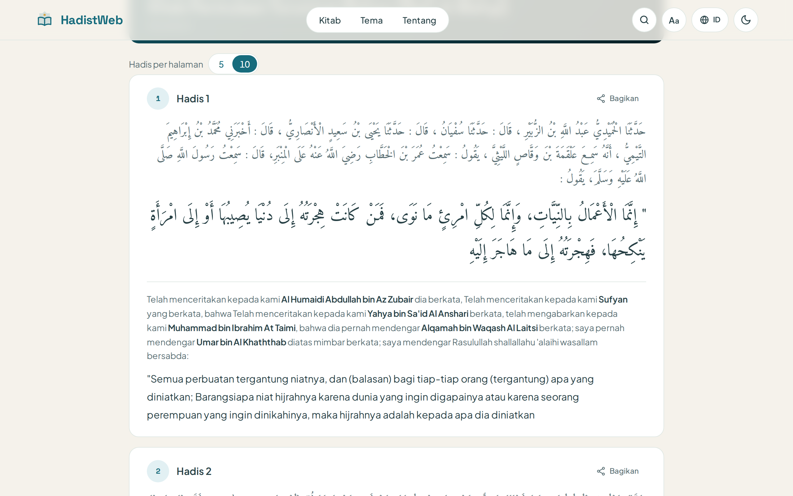
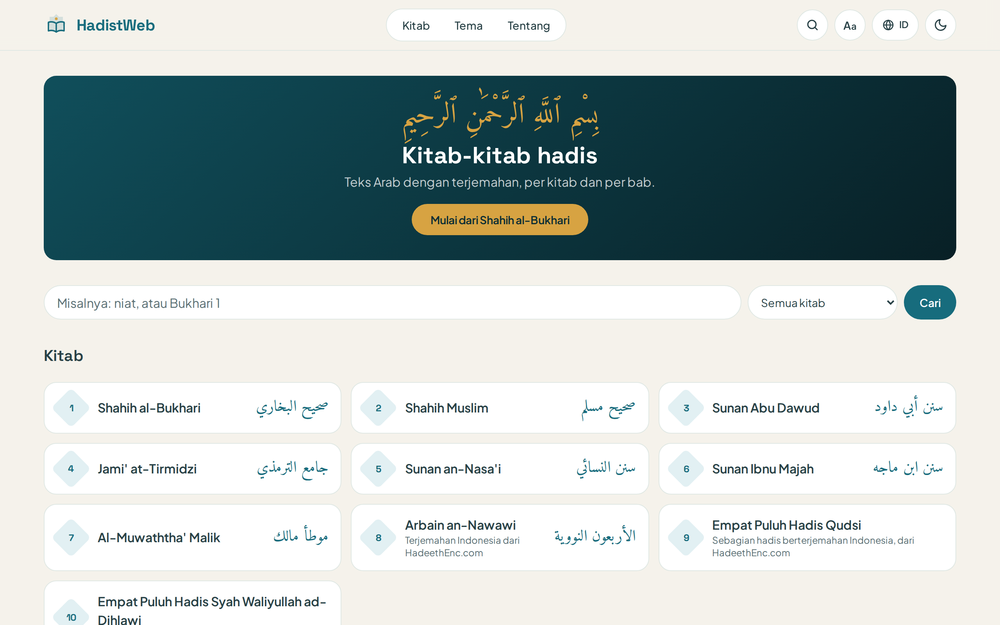
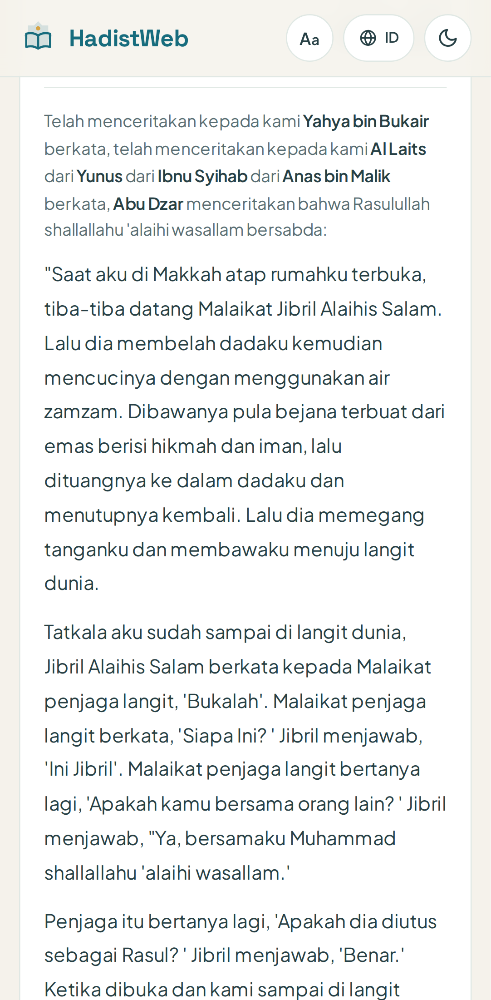
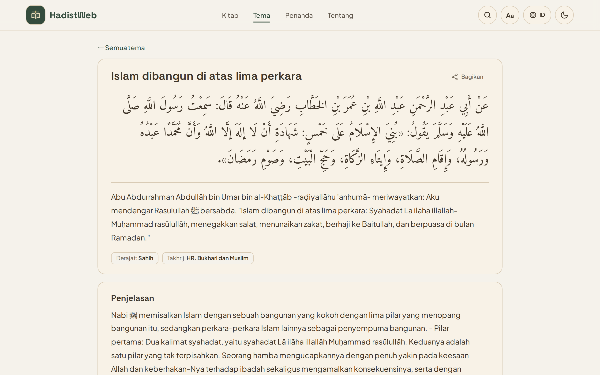
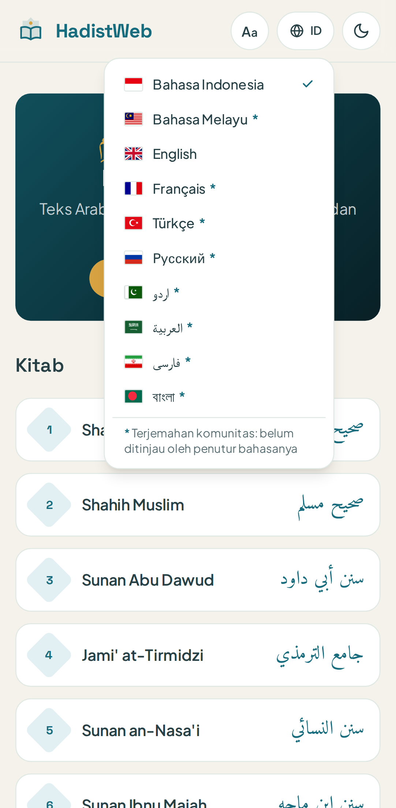
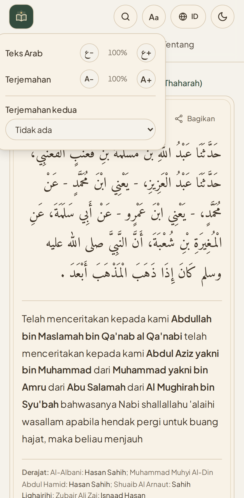
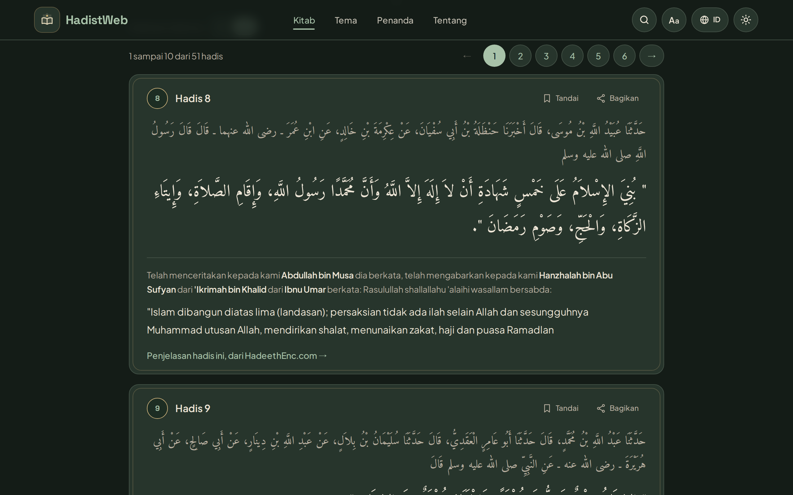

# HadistWeb

[English](README.md) · **Bahasa Indonesia**

Website gratis untuk membaca hadis: teks Arab dengan terjemahan dalam bahasa Anda, kitab demi kitab dan bab demi bab,
serta bagian hadis pilihan per tema, masing-masing dengan penjelasannya. Anda tidak perlu akun, dan tidak ada iklan.

**Buka di https://hadist.udienz.web.id**

## Yang bisa Anda lakukan

- **Membaca sepuluh kitab**: Shahih al-Bukhari, Shahih Muslim, Sunan Abu Dawud, Jami' at-Tirmidzi, Sunan an-Nasa'i,
  Sunan Ibnu Majah, Al-Muwaththa' Malik, dan kumpulan empat puluh hadis an-Nawawi (Arbain), hadis Qudsi, dan Syah Waliyullah
  ad-Dihlawi.
- **Membaca bab demi bab**, seperti kitab cetak, dengan 5 atau 10 hadis per halaman.
- **Membaca hadis per tema** (akidah, salat, adab, dan lainnya), masing-masing dengan derajat, takhrij, penjelasan, dan
  faedahnya.
- **Memakai bahasa Anda**: situs ini tersedia dalam 25 bahasa (lihat tabel di bawah).
- **Membuatnya nyaman dibaca**: tema terang atau gelap, dan huruf Arab serta terjemahan yang bisa diperbesar atau
  diperkecil masing-masing.
- **Membagikan hadis** dengan menyalin tautannya.

## Cara memakai

Gambar menampilkan antarmuka bahasa Indonesia; README bahasa Inggris menampilkan yang berbahasa Inggris.

### Membaca kitab

1. Di beranda, pilih kitab. Daftar babnya muncul.
2. Pilih bab. Setiap hadis menampilkan nomornya, teks Arab, dan terjemahannya.
3. Sanad (rangkaian perawi yang menyampaikan hadis) tampil lebih dulu dengan huruf kecil berwarna abu-abu, lalu isi
   hadis sesudahnya, dibagi menjadi paragraf.
4. Pilih 5 atau 10 hadis per halaman di atas hadis pertama, dan pindah halaman dengan nomor halaman.

### Membaca per tema

1. Buka **Tema** di bagian atas halaman.
2. Pilih tema, lalu hadisnya. Di bawah hadis ada derajat, takhrij (kitab yang meriwayatkannya), penjelasan, dan
   faedahnya.

Tema, penjelasan, dan derajat berasal dari HadeethEnc.com dan ditampilkan persis seperti yang mereka terbitkan.

### Mengganti bahasa

1. Tekan tombol bola dunia di bagian atas (tertulis bahasa yang sedang dipakai, misalnya "ID").
2. Pilih bahasa dari daftar.

Selama Anda belum memilih, situs mengikuti bahasa browser Anda.

### Mengubah ukuran huruf

1. Tekan tombol **Aa** di bagian atas.
2. Perbesar atau perkecil huruf Arab dan terjemahan, masing-masing sendiri.

Pilihan Anda disimpan di browser ini.

### Terang atau gelap

Tekan tombol bulan (atau matahari) di bagian atas. Awalnya situs mengikuti pengaturan perangkat Anda.

### Membagikan hadis

Tekan **Salin tautan** di samping nomor hadis, lalu tempel tautannya di mana saja. Tautan itu membuka hadis tersebut.

## Bahasa

Antarmuka tersedia dalam 25 bahasa, sama dengan [QuranWeb](https://github.com/udienz/quranweb). Bahasa Inggris dan
Indonesia dirawat bersama situs. 23 lainnya adalah **terjemahan komunitas**: draf awal buatan Claude, sebuah AI, yang
belum diperiksa penutur bahasanya. Di menu bahasa, bahasa ini diberi tanda bintang, dan ada tautan untuk melaporkan
kesalahan. Bahasa Arab, Urdu, dan Persia ditulis dari kanan ke kiri, dan seluruh halaman ikut berbalik.

Menu mengurutkan bahasa menurut abjad nama aslinya. Tema dan penjelasannya dari HadeethEnc.com tersedia dalam semua
bahasa ini. Kitab hadis diterjemahkan ke jauh lebih sedikit bahasa, jadi sebagian besar bahasa menampilkan terjemahan
Inggris, seperti tertulis di tabel.

| Bahasa | Antarmuka | Terjemahan hadis | Tema dan penjelasan |
|---|---|---|---|
| Bahasa Indonesia | ya | 7 kitab, ditambah an-Nawawi dan 20 hadis Qudsi | ya |
| Bahasa Melayu | komunitas | tidak ada, yang tampil bahasa Inggris; an-Nawawi dan 20 hadis Qudsi | ya |
| Bosanski (Bosnia) | komunitas | tidak ada, yang tampil bahasa Inggris; an-Nawawi dan 20 hadis Qudsi | ya |
| Deutsch (Jerman) | komunitas | tidak ada, yang tampil bahasa Inggris; sebagian besar an-Nawawi dan 20 hadis Qudsi | ya |
| English | ya | 10 kitab | ya |
| Español (Spanyol) | komunitas | tidak ada, yang tampil bahasa Inggris; an-Nawawi dan 20 hadis Qudsi | ya |
| Français | komunitas | 9 kitab (tanpa Tirmidzi) | ya |
| Hausa | komunitas | tidak ada, yang tampil bahasa Inggris; an-Nawawi dan 20 hadis Qudsi | ya |
| Italiano (Italia) | komunitas | tidak ada, yang tampil bahasa Inggris; beberapa hadis an-Nawawi dan Qudsi | ya |
| Kiswahili (Swahili) | komunitas | tidak ada, yang tampil bahasa Inggris; sebagian besar an-Nawawi dan 20 hadis Qudsi | ya |
| Português (Portugis) | komunitas | tidak ada, yang tampil bahasa Inggris; sebagian besar an-Nawawi dan 20 hadis Qudsi | ya |
| Tiếng Việt (Vietnam) | komunitas | tidak ada, yang tampil bahasa Inggris; sebagian besar an-Nawawi dan 20 hadis Qudsi | ya |
| Türkçe | komunitas | 8 kitab (tanpa Qudsi dan Dihlawi), ditambah 20 hadis Qudsi | ya |
| Русский (Rusia) | komunitas | Bukhari, Muslim, Abu Dawud; an-Nawawi dan 20 hadis Qudsi | ya |
| Ўзбекча (Uzbek) | komunitas | tidak ada, yang tampil bahasa Inggris; sebagian besar an-Nawawi dan 20 hadis Qudsi | ya |
| اردو (Urdu) | komunitas | 7 kitab; an-Nawawi dan 20 hadis Qudsi | ya |
| العربية (Arab) | komunitas | tidak perlu: hadisnya berbahasa Arab | ya |
| فارسی (Persia) | komunitas | tidak ada, yang tampil bahasa Inggris; an-Nawawi dan 20 hadis Qudsi | ya |
| हिन्दी (Hindi) | komunitas | tidak ada, yang tampil bahasa Inggris; an-Nawawi dan 20 hadis Qudsi | ya |
| বাংলা (Bengali) | komunitas | 8 kitab (tanpa Qudsi dan Dihlawi), ditambah 20 hadis Qudsi | ya |
| தமிழ் (Tamil) | komunitas | Bukhari, Muslim; sebagian besar an-Nawawi dan 20 hadis Qudsi | ya |
| മലയാളം (Malayalam) | komunitas | tidak ada, yang tampil bahasa Inggris; sebagian besar an-Nawawi dan 20 hadis Qudsi | ya |
| ไทย (Thai) | komunitas | tidak ada, yang tampil bahasa Inggris; sebagian besar an-Nawawi dan 20 hadis Qudsi | ya |
| 中文 (Mandarin) | komunitas | tidak ada, yang tampil bahasa Inggris; an-Nawawi dan 20 hadis Qudsi | ya |
| 日本語 (Jepang) | komunitas | tidak ada, yang tampil bahasa Inggris; sekitar separuh an-Nawawi dan 20 hadis Qudsi | ya |

Kalau sebuah hadis tidak punya terjemahan dalam bahasa Anda, terjemahan Inggris yang tampil (atau terjemahan
Indonesia), dengan keterangan. Sebagian terjemahan Indonesia menggabungkan beberapa riwayat menjadi satu, jadi beberapa
hadis tidak punya teks Indonesia sendiri dan menampilkan terjemahan Inggris.

Nama bab memakai bahasa Indonesia untuk pembaca Indonesia, dan bahasa Inggris untuk bahasa lainnya.

## Sumber teks

- Sepuluh kitab dan terjemahannya: [fawazahmed0/hadith-api](https://github.com/fawazahmed0/hadith-api).
- Tema, penjelasan, dan derajat, serta terjemahan Indonesia untuk empat puluh hadis an-Nawawi dan 20 hadis Qudsi:
  [HadeethEnc.com](https://hadeethenc.com/), terbitan Rowwad Translation Center.

Teks hadis dan terjemahannya ditampilkan seperti yang diterbitkan sumbernya, dan tidak pernah diedit di situs ini.
Hanya tata letaknya yang berubah: sanad dipisahkan dan teks panjang dibagi menjadi paragraf, tanpa mengubah satu huruf
pun. Kode situs memakai lisensi MIT ([LICENSE](LICENSE)); teksnya mengikuti ketentuan sumbernya.

## Privasi

Tanpa akun, tanpa riwayat bacaan, tanpa iklan. Dua kuki kecil mengingat bahasa Anda dan jumlah hadis per halaman.
Kunjungan dihitung dengan Cloudflare Web Analytics, yang menurut Cloudflare tidak memasang kuki dan tidak mengenali
Anda. Rinciannya ada di [halaman privasi](https://hadist.udienz.web.id/privacy).

## Menemukan kesalahan, atau ingin membantu?

- Terjemahan antarmuka yang salah atau janggal: pakai tautan **Laporkan kesalahan terjemahan** di menu bahasa, atau
  formulir [Translation mistake](https://github.com/udienz/hadistweb/issues/new?template=translation_mistake.yml).
- Sesuatu yang tidak berjalan: buka [laporan bug](https://github.com/udienz/hadistweb/issues/new?template=bug_report.yml).
- Masalah keamanan: laporkan secara pribadi, seperti dijelaskan di [SECURITY.md](SECURITY.md).
- Untuk menyumbang kode atau terjemahan: lihat [CONTRIBUTING.md](CONTRIBUTING.md). Semua yang ikut serta mengikuti
  [kode etik](CODE_OF_CONDUCT.md). Isi kedua berkas ini dalam bahasa Inggris.
- Menjalankan situs sendiri, tes, dan deploy: [docs/development.md](docs/development.md) (bahasa Inggris).

HadistWeb memakai desain yang sama dengan [QuranWeb](https://github.com/udienz/quranweb), website untuk membaca
Al-Qur'an.
