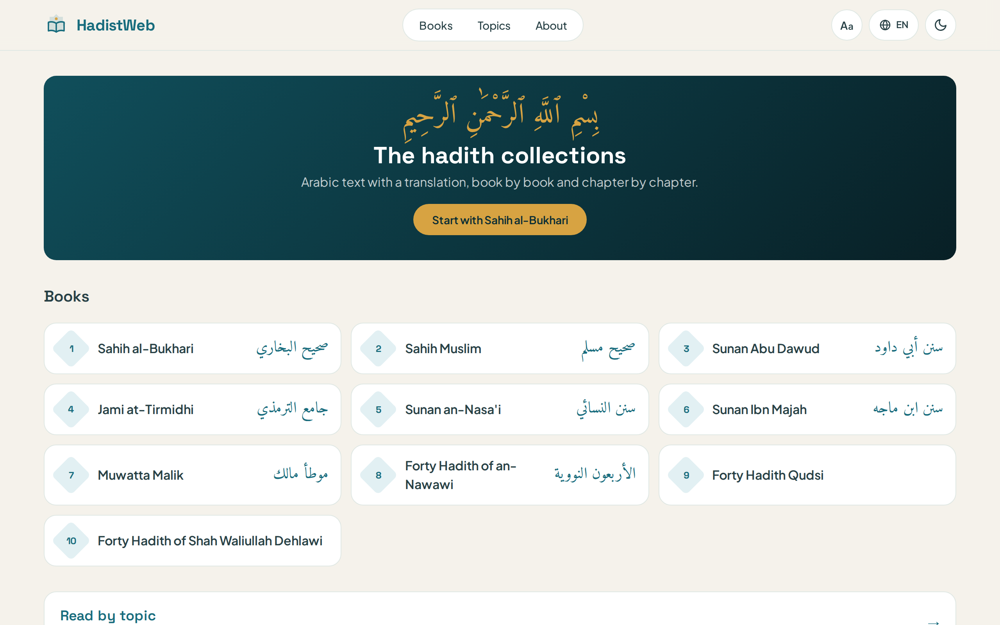
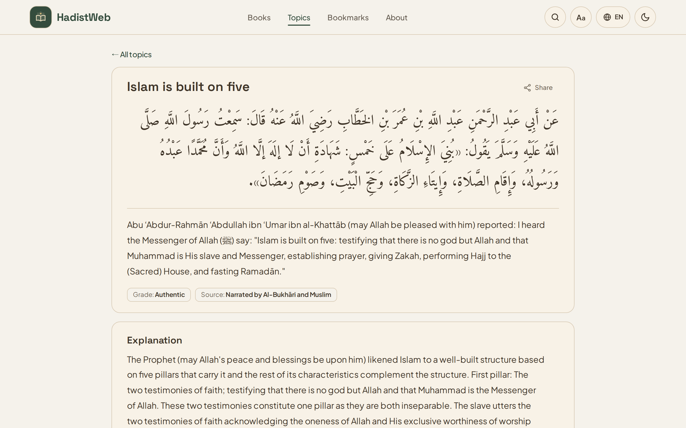
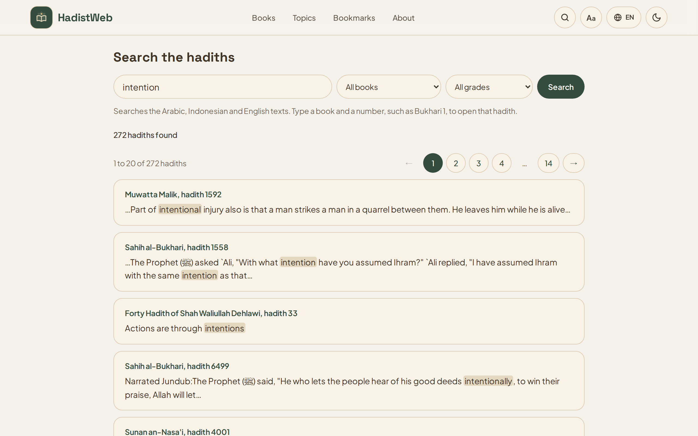
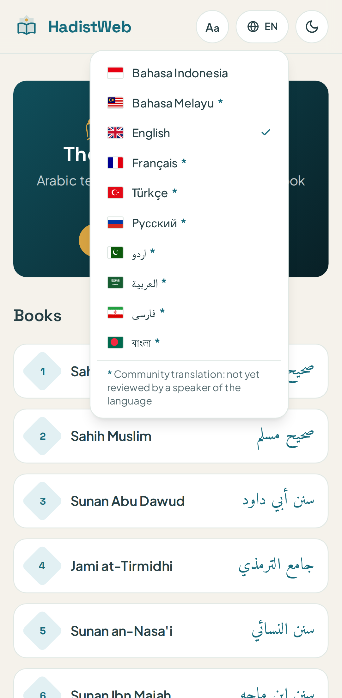
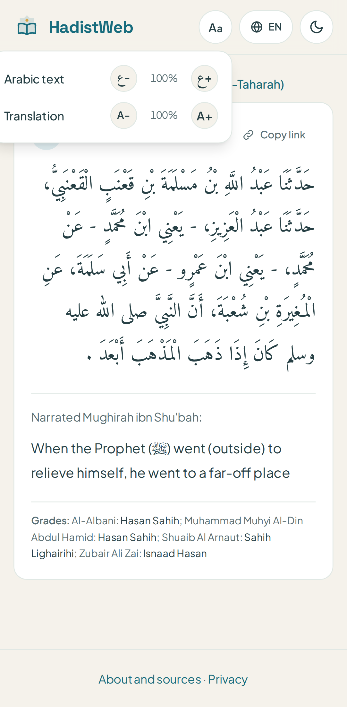
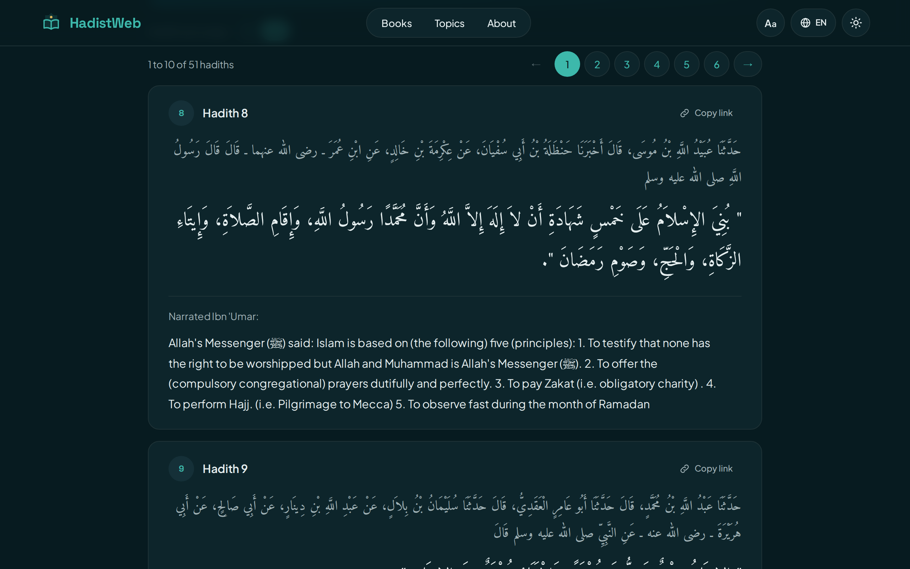

# HadistWeb

**English** · [Bahasa Indonesia](README.id.md)

A free website for reading hadith: the Arabic text with a translation in your language, book by book and chapter by
chapter, and a section of selected hadiths by topic, each with an explanation. You don't need an account, and there are
no ads.

**Open it at https://hadist.udienz.web.id**

## What you can do

- **Read ten collections**: Sahih al-Bukhari, Sahih Muslim, Sunan Abu Dawud, Jami at-Tirmidhi, Sunan an-Nasa'i, Sunan
  Ibn Majah, Muwatta Malik, and the forty-hadith collections of an-Nawawi, of hadith Qudsi and of Shah Waliullah Dehlawi.
- **Read chapter by chapter**, like a printed book, with 5 or 10 hadiths on a page.
- **Read hadiths by topic** (belief, prayer, manners and more), each with its grade, its sources, an explanation and the
  lessons drawn from it.
- **Read in your language**: the site is in 25 languages (see the table below).
- **Make it comfortable to read**: a light or dark theme, and larger or smaller letters for the Arabic and the
  translation separately.
- **Search** the Arabic text and the Indonesian and English translations, or type a book and number such as
  "Bukhari 1" to open that hadith.
- **A hadith of the day** on the home page, from an-Nawawi's forty hadiths, a new one each day (Indonesian time).
- **Bookmark hadiths** and **continue reading** where you stopped, from the home page.
- **Install it as an app** on your phone or computer, with its own icon.
- **Share a hadith**: copy its text with the reference and link, or send it straight to WhatsApp. A shared link shows
  the hadith's title and opening words in the preview.

## How to use it

The pictures show the English interface; the Indonesian README shows the Indonesian one.

### Read a book

1. On the home page, pick a book. You see its list of chapters.
2. Pick a chapter. Each hadith shows its number, the Arabic text and the translation.
3. The chain of narrators (who passed the hadith on to whom) is shown first, in small grey letters, and the words of
   the hadith after it, in paragraphs. Where a translation cites a verse of the Qur'an, such as "QS. Luqman: 34" or
   "(3.77)", the reference links to that verse on [QuranWeb](https://quranweb.udienz.web.id).
4. Choose 5 or 10 hadiths per page above the first hadith, and move between pages with the numbers.
5. In the Sunan books and Malik, show **All** hadiths, only **Sahih and hasan**, or only **Sahih**, by the grades of
   one scholar (Al-Albani; Salim al-Hilali for Malik). Bukhari and Muslim have no filter: all their hadiths are sahih.
   The search page has the same choice.

### Read by topic

1. Open **Topics** at the top of the page.
2. Pick a topic, then a hadith. Under the hadith you find its grade, where it is recorded, the explanation and its lessons.

The topics, explanations and grades come from HadeethEnc.com and are shown exactly as they publish them.

About 2,300 hadiths in the books also link to their explanation: look for **Explanation of this hadith** under the
translation. The explanation page lists, under **In the books**, where the same hadith is in the books.

### Read by narrator

Open **Read by narrator** on the home page, or press a name in the chain of narrators of an Indonesian translation. A
narrator's page lists the hadiths whose chain has that name. Search the names at the top of the list.

The names are taken as the Indonesian translation writes them, so one narrator can appear under several spellings, and
different narrators can share a name.

### Search

1. Press the magnifying glass at the top, or use the search box on the home page.
2. Type a few words, in the Arabic text or in the Indonesian or English translation. Spellings such as *shalat*,
   *sholat* and *salat* find each other. Choose a book to search only in it.
3. To open a hadith you know, type its book and number, such as *Bukhari 1* or *HR. Muslim no. 8*.

A reader of the Turkish, Bengali, French, Russian, Urdu or Tamil interface searches that translation first.

### Change the language

1. Press the globe button at the top (it shows the current language, such as "EN").
2. Pick a language from the list.

Until you pick one, the site follows the language of your browser.

### Change the size of the letters

1. Press the **Aa** button at the top.
2. Make the Arabic letters and the translation larger or smaller, each on its own.

Your choice is kept in this browser.

In the same menu, **Second translation** puts another translation beside the first, for example English next to
Indonesian: side by side on a wide screen, one under the other on a phone.

### Bookmarks and continue reading

1. Press **Bookmark** beside a hadith's number. Press it again to remove the bookmark.
2. The home page shows **Continue reading** with the last hadith you read, and a link to your bookmarks.
3. On the **Bookmarks** page, open a hadith or remove it from the list.

Bookmarks and the last hadith read are kept in this browser only. Another browser or phone has its own.

### Install it as an app

On a phone or computer, HadistWeb can have its own icon and window: "Install app" in Chrome or Edge (in the menu, or
the icon in the address bar), "Add to Home Screen" in Safari on an iPhone. It still needs an internet connection.

### Light or dark

Press the moon (or sun) button at the top. At first the site follows your device's setting.

### Share a hadith

Press **Share** beside the hadith number, then choose:

- **Copy text**: the Arabic text, the translation, the reference (such as "Shahih al-Bukhari, hadith 1") and the link,
  ready to paste into a chat or a document.
- **Copy link**: only the address of the hadith.
- **Share via…** (on phones): the phone's own list of apps.
- **WhatsApp**: opens WhatsApp with the text filled in.

## Languages

The interface is in 25 languages, the same as [QuranWeb](https://github.com/udienz/quranweb). English and Indonesian
are kept up to date with the site. The other 23 are **community translations**: first drafts made by Claude, an AI, not
yet checked by a speaker of the language. They are marked with an asterisk in the language menu, which also has a link
to report a mistake. Arabic, Urdu and Persian are written right to left, and the whole page turns with them.

The menu lists the languages alphabetically by their own names. The topics and their explanations come from HadeethEnc.com
in every one of these languages. The hadith books are translated into far fewer, so most languages show the English
translation, as the table says.

| Language | Interface | Hadith translation | Topics and explanations |
|---|---|---|---|
| Bahasa Indonesia | yes | 7 books, plus an-Nawawi and 20 Qudsi hadiths | yes |
| Bahasa Melayu | community | none, English is shown; an-Nawawi and 20 Qudsi hadiths | yes |
| Bosanski (Bosnian) | community | none, English is shown; an-Nawawi and 20 Qudsi hadiths | yes |
| Deutsch (German) | community | none, English is shown; most of an-Nawawi and the 20 Qudsi hadiths | yes |
| English | yes | all 10 books | yes |
| Español (Spanish) | community | none, English is shown; an-Nawawi and 20 Qudsi hadiths | yes |
| Français | community | 9 books (not Tirmidhi) | yes |
| Hausa | community | none, English is shown; an-Nawawi and 20 Qudsi hadiths | yes |
| Italiano (Italian) | community | none, English is shown; a few an-Nawawi and Qudsi hadiths | yes |
| Kiswahili (Swahili) | community | none, English is shown; most of an-Nawawi and the 20 Qudsi hadiths | yes |
| Português (Portuguese) | community | none, English is shown; most of an-Nawawi and the 20 Qudsi hadiths | yes |
| Tiếng Việt (Vietnamese) | community | none, English is shown; most of an-Nawawi and the 20 Qudsi hadiths | yes |
| Türkçe | community | 8 books (not Qudsi or Dehlawi), plus 20 Qudsi hadiths | yes |
| Русский (Russian) | community | Bukhari, Muslim, Abu Dawud; an-Nawawi and 20 Qudsi hadiths | yes |
| Ўзбекча (Uzbek) | community | none, English is shown; most of an-Nawawi and the 20 Qudsi hadiths | yes |
| اردو (Urdu) | community | 7 books; an-Nawawi and 20 Qudsi hadiths | yes |
| العربية (Arabic) | community | not needed: the hadiths are in Arabic | yes |
| فارسی (Persian) | community | none, English is shown; an-Nawawi and 20 Qudsi hadiths | yes |
| हिन्दी (Hindi) | community | none, English is shown; an-Nawawi and 20 Qudsi hadiths | yes |
| বাংলা (Bengali) | community | 8 books (not Qudsi or Dehlawi), plus 20 Qudsi hadiths | yes |
| தமிழ் (Tamil) | community | Bukhari, Muslim; most of an-Nawawi and the 20 Qudsi hadiths | yes |
| മലയാളം (Malayalam) | community | none, English is shown; most of an-Nawawi and the 20 Qudsi hadiths | yes |
| ไทย (Thai) | community | none, English is shown; most of an-Nawawi and the 20 Qudsi hadiths | yes |
| 中文 (Chinese) | community | none, English is shown; an-Nawawi and 20 Qudsi hadiths | yes |
| 日本語 (Japanese) | community | none, English is shown; about half of an-Nawawi and the 20 Qudsi hadiths | yes |

When a hadith has no translation in your language, the English one is shown (or the Indonesian one), with a note saying
so. Some Indonesian translations join several narrations into one, so a few hadiths have no Indonesian text of their own
and show the English one.

Chapter names are in Indonesian for Indonesian readers and in English in the other languages.

## Where the texts come from

- The ten books and their translations: [fawazahmed0/hadith-api](https://github.com/fawazahmed0/hadith-api).
- The topics, explanations and grades, and the Indonesian translation of an-Nawawi's forty hadiths and of 20 Qudsi
  hadiths: [HadeethEnc.com](https://hadeethenc.com/), by the Rowwad Translation Center.

The hadith texts and translations are shown as their sources publish them, and are never edited on this site. Only the
layout changes: the chain of narrators is set apart and long texts are split into paragraphs, without changing a
letter. The site's code is under the MIT licence ([LICENSE](LICENSE)); the texts keep the terms of their sources.

## Privacy

No accounts and no ads. Your bookmarks and the last hadith you read stay in your browser, never on our server. Two
small cookies remember your language and how many hadiths a page shows.
Visits are counted with Cloudflare Web Analytics, which, according to Cloudflare, sets no cookies and does not identify
you. The details are on the site's [privacy page](https://hadist.udienz.web.id/privacy).

## Found a mistake, or want to help?

- A wrong or odd translation of the interface: use the **Report a translation mistake** link in the language menu, or the
  [Translation mistake](https://github.com/udienz/hadistweb/issues/new?template=translation_mistake.yml) form.
- Something that doesn't work: open a [bug report](https://github.com/udienz/hadistweb/issues/new?template=bug_report.yml).
- A security problem: please report it privately, as described in [SECURITY.md](SECURITY.md).
- To contribute code or a translation: see [CONTRIBUTING.md](CONTRIBUTING.md). Everyone taking part follows the
  [code of conduct](CODE_OF_CONDUCT.md).
- Running the site yourself, tests and deployment: [docs/development.md](docs/development.md).

HadistWeb shares its design with [QuranWeb](https://github.com/udienz/quranweb), a website for reading the Qur'an.
