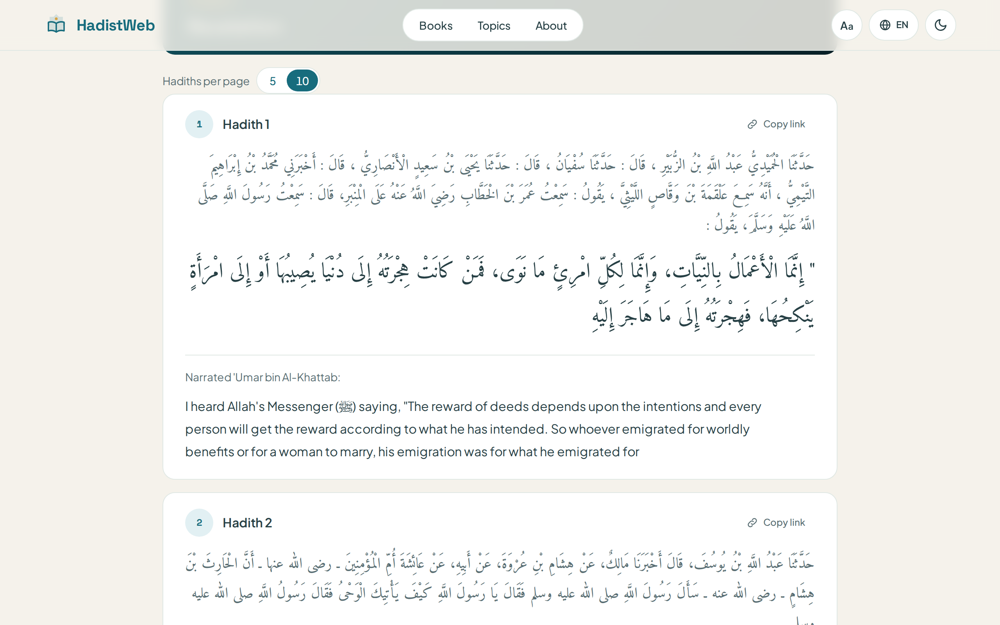
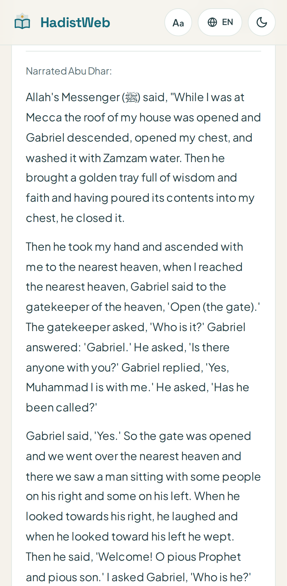

# HadistWeb

**English** · [Bahasa Indonesia](README.id.md)

A free website for reading hadith: the Arabic text with a translation in your language, book by book and chapter by
chapter, and a section of selected hadiths by topic, each with an explanation. You don't need an account, and there are
no ads.

**Open it at https://hadist.udienz.web.id**

## What you can do

- **Read ten collections**: Sahih al-Bukhari, Sahih Muslim, Sunan Abu Dawud, Jami at-Tirmidhi, Sunan an-Nasa'i, Sunan
  Ibn Majah, Muwatta Malik, and the forty-hadith collections of an-Nawawi, of hadith Qudsi and of Shah Waliullah Dehlawi.
- **Read chapter by chapter**, like a printed book, with 5 or 10 hadiths on a page.
- **Read hadiths by topic** (belief, prayer, manners and more), each with its grade, its sources, an explanation and the
  lessons drawn from it.
- **Read in your language**: the site is in ten languages (see the table below).
- **Make it comfortable to read**: a light or dark theme, and larger or smaller letters for the Arabic and the
  translation separately.
- **Share a hadith** by copying its link.

## How to use it

The pictures show the English interface; the Indonesian README shows the Indonesian one.

### Read a book

1. On the home page, pick a book. You see its list of chapters.
2. Pick a chapter. Each hadith shows its number, the Arabic text and the translation.
3. The chain of narrators (who passed the hadith on to whom) is shown first, in small grey letters, and the words of
   the hadith after it, in paragraphs.
4. Choose 5 or 10 hadiths per page above the first hadith, and move between pages with the numbers.

### Read by topic

1. Open **Topics** at the top of the page.
2. Pick a topic, then a hadith. Under the hadith you find its grade, where it is recorded, the explanation and its lessons.

The topics, explanations and grades come from HadeethEnc.com and are shown exactly as they publish them.

### Change the language

1. Press the globe button at the top (it shows the current language, such as "EN").
2. Pick a language from the list.

Until you pick one, the site follows the language of your browser.

### Change the size of the letters

1. Press the **Aa** button at the top.
2. Make the Arabic letters and the translation larger or smaller, each on its own.

Your choice is kept in this browser.

### Light or dark

Press the moon (or sun) button at the top. At first the site follows your device's setting.

### Share a hadith

Press **Copy link** beside the hadith number, then paste the link wherever you like. The link opens that hadith.

## Languages

The interface is in ten languages. English and Indonesian are kept up to date with the site. The other eight are
**community translations**: first drafts made by Claude, an AI, not yet checked by a speaker of the language. They are
marked with an asterisk in the language menu, which also has a link to report a mistake. Arabic, Urdu and Persian are
written right to left, and the whole page turns with them.

| Language | Interface | Hadith translation | Topics and explanations |
|---|---|---|---|
| English | yes | all 10 books | yes |
| Bahasa Indonesia | yes | 7 books, plus an-Nawawi and 20 Qudsi hadiths | yes |
| Türkçe | community | 8 books (not Qudsi or Dehlawi), plus 20 Qudsi hadiths | yes |
| Bahasa Melayu | community | none, English is shown; an-Nawawi and 20 Qudsi hadiths | yes |
| বাংলা (Bengali) | community | 8 books (not Qudsi or Dehlawi), plus 20 Qudsi hadiths | yes |
| Français | community | 9 books (not Tirmidhi) | yes |
| Русский | community | Bukhari, Muslim, Abu Dawud; an-Nawawi and 20 Qudsi hadiths | yes |
| اردو (Urdu) | community | 7 books; an-Nawawi and 20 Qudsi hadiths | yes |
| العربية | community | not needed: the hadiths are in Arabic | yes |
| فارسی (Persian) | community | none, English is shown; an-Nawawi and 20 Qudsi hadiths | yes |

When a hadith has no translation in your language, the English one is shown (or the Indonesian one), with a note saying
so. Some Indonesian translations join several narrations into one, so a few hadiths have no Indonesian text of their own
and show the English one.

Chapter names are in Indonesian for Indonesian readers and in English in the other languages.

## Where the texts come from

- The ten books and their translations: [fawazahmed0/hadith-api](https://github.com/fawazahmed0/hadith-api).
- The topics, explanations and grades, and the Indonesian translation of an-Nawawi's forty hadiths and of 20 Qudsi
  hadiths: [HadeethEnc.com](https://hadeethenc.com/), by the Rowwad Translation Center.

The hadith texts and translations are shown as their sources publish them, and are never edited on this site. Only the
layout changes: the chain of narrators is set apart and long texts are split into paragraphs, without changing a
letter. The site's code is under the MIT licence ([LICENSE](LICENSE)); the texts keep the terms of their sources.

## Privacy

No accounts, no reading history, no ads. Two small cookies remember your language and how many hadiths a page shows.
Visits are counted with Cloudflare Web Analytics, which, according to Cloudflare, sets no cookies and does not identify
you. The details are on the site's [privacy page](https://hadist.udienz.web.id/privacy).

## Found a mistake, or want to help?

- A wrong or odd translation of the interface: use the **Report a translation mistake** link in the language menu, or the
  [Translation mistake](https://github.com/udienz/hadistweb/issues/new?template=translation_mistake.yml) form.
- Something that doesn't work: open a [bug report](https://github.com/udienz/hadistweb/issues/new?template=bug_report.yml).
- A security problem: please report it privately, as described in [SECURITY.md](SECURITY.md).
- To contribute code or a translation: see [CONTRIBUTING.md](CONTRIBUTING.md). Everyone taking part follows the
  [code of conduct](CODE_OF_CONDUCT.md).
- Running the site yourself, tests and deployment: [docs/development.md](docs/development.md).

HadistWeb shares its design with [QuranWeb](https://github.com/udienz/quranweb), a website for reading the Qur'an.
